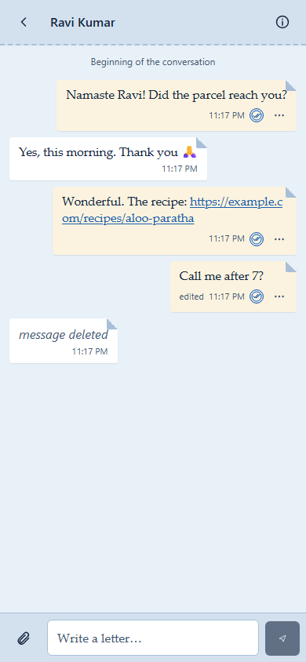
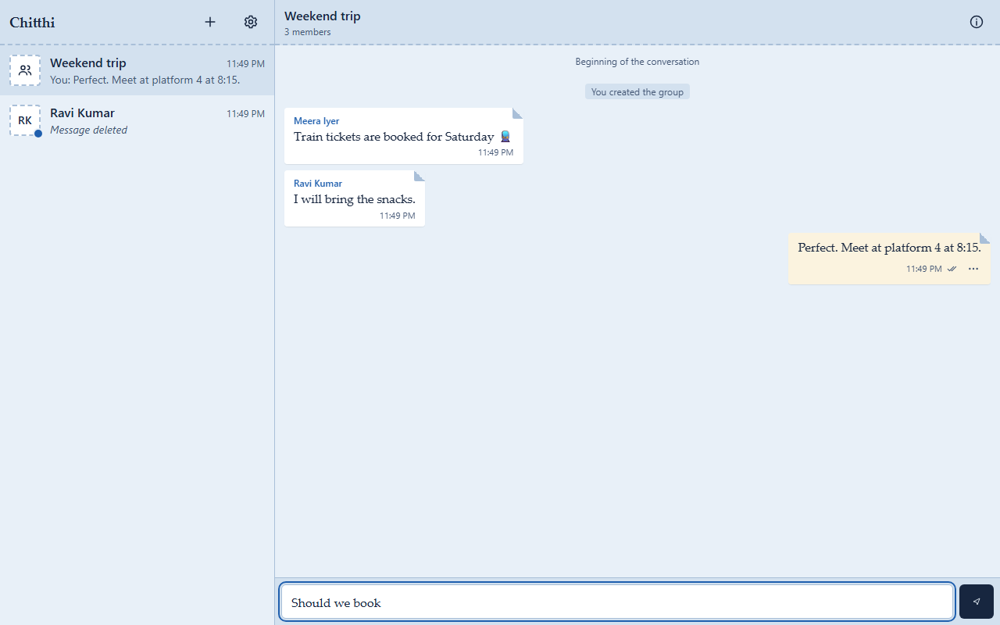
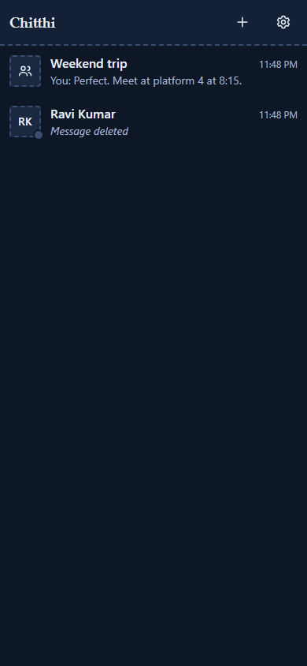
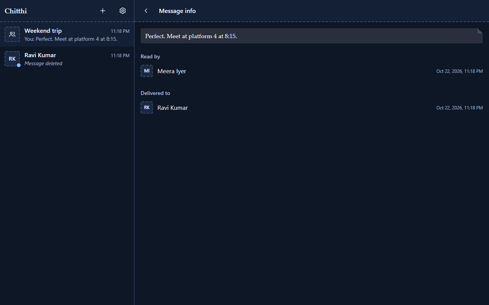
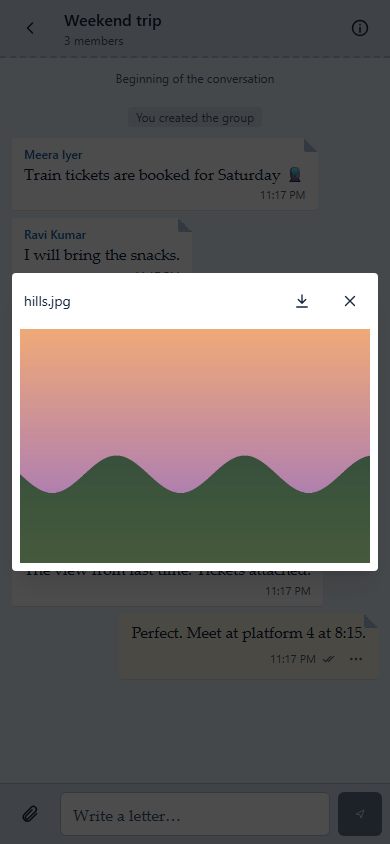
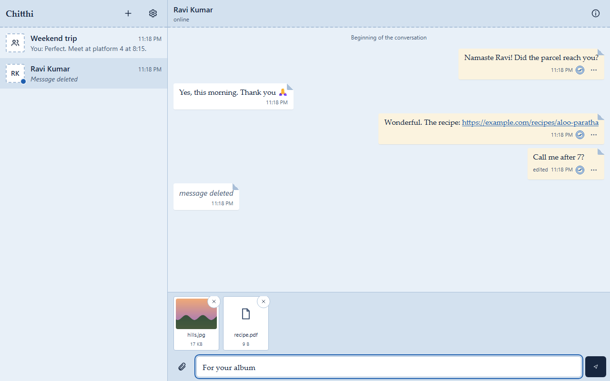

# Chitthi

A real-time chat app: 1:1 and group conversations, durable ordered history, read receipts, presence and typing indicators.

> **Status: rewrite in progress.** The API (data model, REST, real-time delivery) is built and tested; the web app is a skeleton until the frontend phase.

**Not end-to-end encrypted.** Messages are stored in plaintext on the server, which can read them. There are no voice or video calls.

**Backups keep deleted content for a while.** Nightly encrypted backups are append-only, so a message deleted for everyone, or an erased account's messages and files, stays in them until they expire: up to about 7 weeks for messages and up to 12 weeks for files ([docs/MAINTENANCE.md](docs/MAINTENANCE.md#backups)).

## Screens

The look is the old blue inland letter: pale blue paper, letters with a folded corner (yours on cream airmail paper), postage-stamp avatars, and a postmark for "read".

| Phone (390 px) | Desktop |
|---|---|
|  |  |
|  |  |
|  |  |

Every screen, at 390 px and on desktop, in light and dark: [docs/img/](docs/img/). Regenerate them with `SCREENSHOTS=1 npm run e2e -w web -- e2e/screenshots.spec.ts --project=desktop`.

## Stack

Node 22 · TypeScript · Express 5 · PostgreSQL 18 · Socket.IO · React 19 · Vite · Tailwind CSS v4 · TanStack Query

## Running locally

Requirements: Node 22.12 or later, and Docker.

```sh
cp .env.example .env        # then set the owner and chitthi_api passwords (see comments inside)
npm ci
docker compose up -d db     # Postgres on 127.0.0.1:5435
npm run db:migrate
npm run db:api-password     # sets the chitthi_api login from DATABASE_URL
npm run dev:api             # http://127.0.0.1:8082/api/health
npm run dev:web             # http://localhost:5175
```

Uploaded media goes to `.data/media` in the repo (git-ignored). `npm run dev:reset-media` deletes all of it, files and attachment rows, when you are done testing. On a nearly full drive, the dev-only `MEDIA_MIN_FREE_PERCENT` / `MEDIA_MIN_FREE_BYTES` in `.env.example` loosen the upload disk guard. See [docs/MEDIA.md](docs/MEDIA.md).

To sign in with Google or GitHub, set the client id and secret pairs (in `.env` or `api/.env`) and register `http://localhost:5175/api/auth/{google,github}/callback` as redirect URIs. Without them, development uses the `DEV_LOGIN` handle shortcut. See [docs/AUTH.md](docs/AUTH.md).

## Docs

- [docs/AUDIT.md](docs/AUDIT.md): audit of the legacy codebase and the plan for this rewrite.
- [docs/SCHEMA.md](docs/SCHEMA.md): the data model and what the database enforces.
- [docs/PHASE7-PREP.md](docs/PHASE7-PREP.md): constraints and known issues for the deploy phase.
- [docs/MEDIA.md](docs/MEDIA.md): photos and files: storage, uploads, type checks, quotas.
- [docs/AUTH.md](docs/AUTH.md): Google and GitHub sign-in, onboarding, linking and sessions.
- [docs/REALTIME.md](docs/REALTIME.md): real-time delivery, the guarantees, failure modes and the client sync contract.
- [CLAUDE.md](CLAUDE.md): invariants, phases and working rules.

## Licence

MIT
